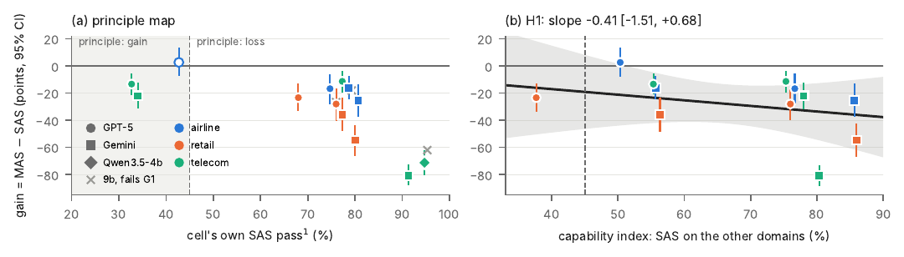

# Does Multi-Agent Collaboration Pay When Agents Serve Users?

**Testing agent scaling in dual-control settings**

[Ethan Yang](mailto:eyyang@seas.upenn.edu) and [Xiangcheng Shi](mailto:xcshi@seas.upenn.edu), University of Pennsylvania

[](paper/main.pdf)
[-blue.svg)](data/README.md)
[](PREREGISTRATION.md)
[](LICENSE)
[](LICENSE-DATA)

The first pre-registered, compute-matched test of an agent-scaling rule where agents serve users in conversation. Code, prompts, run configuration, 7,950 simulated conversations with per-call token records and budget ledgers, the pre-registered plan with its change log, and the paper.

## Overview

Should a deployed agent be one model acting alone, or a team of agents that plan, check and specialize? The most systematic answer so far is an empirical scaling rule for agent systems: coordination pays while the underlying single agent is weak and costs once it is strong, with the crossing near 45% single-agent accuracy ([Kim et al., 2026](https://doi.org/10.1038/s42256-026-01268-y)). That rule, like every scaling result for agent systems so far, was derived on autonomous benchmarks, where the agent receives a task and acts alone. The agents now reaching people work in a different regime. They converse with a user who supplies information late, changes goals and asks for what the policy forbids; they act on a shared database or device; and every extra model call is paid for inside a long conversation. Whether scaling rules derived without a user survive one had not been tested.

This repository holds the first pre-registered, compute-matched test of agent scaling in that regime. On the airline, retail and telecom domains of $\tau^2$-bench, the benchmark's stock single-agent system (SAS) is compared with a centralized multi-agent system (MAS) built from the same model, for six models from three families, over 7,950 simulated conversations, with each system held to one per-episode completion-token ledger calibrated from the SAS's own spend.

**What we found.**

1. **The rule does not carry over.** Under a fixed simulated user no cell shows a MAS benefit. The MAS is worse than the SAS in 12 of the 13 cells that meet the mechanical validity bars and tied in the thirteenth, the cell nearest 45%.
2. **It fails where it is most specific.** On the two cells where the rule predicts a benefit, the MAS loses by 13 and 22 points. Removing the budget ceiling altogether brings it at best level with the SAS, at 5.5 times the SAS's median token spend.
3. **The loss comes from dividing the work, and the division buys nothing it was meant to buy.** Exhausted episodes carry 74% of the mean loss. A single agent that runs the same plan-and-review cycle in one context matches the SAS under the same ceiling on the three cells tested, while the MAS trails both on the two cells below 45%. The mechanism that would justify a MAS here, intercepting wrongful database writes, shows no measurable effect; the MAS converts other failures into budget exhaustion and inaction instead.
4. **Whether the gain declines with capability is left open.** On a capability index measured on held-out domains, the slope is $-0.41$ with a 95% CI of $[-1.51, +0.68]$: model-by-domain effects dominate the variation between cells, and the design cannot resolve the question either way. The level, however, is clear: the fitted gain is negative across the whole observed range.

**What the study adds beyond the result.**

- *A compute-matching protocol for multi-turn agent systems.* One completion-token ledger per episode, shared by every agent of a system, calibrated per cell from the SAS's own spend, with wrap-up and exhaustion rules and validity bars read from logs rather than from reward. Prior protocols matched iterations, thinking tokens per call or dollars after the fact; none was built for conversations in which a simulated user adds tokens the agent does not control.
- *A correction to how capability dependence is measured.* Regressing a gain on the baseline it is computed from yields a negative slope by construction (a coupling lemma in the paper, with proof). The index must come from other episodes; here, from the model's SAS score on the other two domains.
- *A failure taxonomy for agents under a written policy.* Wrongful writes (visible to the official reward), inaction, budget exhaustion and verbal violations (invisible to it) are separated per episode, so a MAS that trades one failure for another is read as such.
- *A complete, pre-registered record.* The plan with its dated change log, every trajectory with per-call token usage and ledger state, every prompt, manifest and derived table, and 65 offline tests.

**What to keep in mind.** The MAS is reported as built: its orchestrator planned without the tool schemas that only the database agent holds, one pre-registered validity bar (90% of write orders executed as issued) was not met, and the paper labels this a deviation rather than re-running the grid. One architecture is tested, the user is a model, and only the telecom domain gives the user tools of its own. The result is a null for this architecture in this regime. What it changes is where the burden of proof sits: with compute-matched evidence from the setting itself.



*(a) Each cell's own SAS pass¹ against the MAS gain. The rule predicts a gain left of the 45% line and a loss right of it. (b) The same gains against the leave-one-domain-out capability index with the weighted fit and its 95% band.*

## Headline numbers

The grid at $B = 4B_{1\times}$ (pass¹ in percent, 150 episodes per system, task-cluster bootstrap CIs; paper Table 5).

| Model | Airline | Retail | Telecom |
|---|---|---|---|
| gpt-5-nano | 42.7 → 45.3 (+2.7 [−6.7, +12.7]) | 68.0 → 44.7 (−23.3 [−32.7, −13.3]) | 32.7 → 19.3 (−13.3 [−20.7, −6.0]) |
| gpt-5-mini | 74.7 → 58.0 (−16.7 [−27.3, −6.7]) | 76.0 → 48.0 (−28.0 [−40.0, −17.3]) | 77.3 → 66.0 (−11.3 [−18.7, −4.0]) |
| gemini-3.1-flash-lite | 78.7 → 62.7 (−16.0 [−24.0, −8.0]) | 77.3 → 41.3 (−36.0 [−47.3, −24.0]) | 34.0 → 12.0 (−22.0 [−30.7, −12.7]) |
| gemini-3-flash | 80.7 → 55.3 (−25.3 [−36.7, −14.0]) | 80.0 → 25.3 (−54.7 [−66.0, −44.0]) | 91.3 → 10.7 (−80.7 [−87.3, −73.3]) |
| qwen3.5-4b (local, 4-bit) | appendix (sensitivity) | appendix (October build) | 94.7 → 23.3 (−71.3 [−80.0, −62.7]) |
| qwen3.5-9b (hosted) | 79.3 → 61.3 (fails mechanical bars) | 76.0 → 49.3 (fails) | 95.3 → 33.3 (fails) |

Each entry reads SAS → MAS (gain [95% CI]). Telecom × gemini-3.1-flash-lite and telecom × gpt-5-nano are the two cells below 45%; airline × gpt-5-nano straddles it.

## What is in this repository

```
.
├── README.md, PREREGISTRATION.md, PROVENANCE.md, LICENSE, LICENSE-DATA, CITATION.cff
├── setup.sh                 clones tau2-bench at the pinned commit, installs it, links the data
├── s1_agent.py              the stock SAS under the ledger (S1)
├── m1_agent.py              the centralized MAS: orchestrator, database agent, policy advisor (M1)
├── s2_agent.py              the strong SAS: plan-and-review in one context (S2)
├── budget_layer.py, completion_budget.py     the per-episode completion-token ledger
├── run_calibration.py       uncapped SAS runs that calibrate the budget of each cell
├── build_budgets.py, calibrate_budget.py     B_1x, c, w, a_min per cell  ->  budgets.json
├── run_m1.py                budgeted runs of M1, capped S1 and S2 through tau2's Python API
├── cells.json, budgets.json, task_subsets.json, pricing.json   the frozen run configuration
├── prompts/                 base prompt, wrap-up notice, the role blocks (hashed in the manifests)
├── tests/                   65 offline tests on tau2's mock domain (no API calls)
├── analyze_run.py, cell_report.py, fill_cell.py, smoke_health.py   per-run readers
├── h1_extract.py, h1_analysis.py, h1_sensitivity.py   H1: gain on the capability index
├── h4_extract.py, h4_analysis.py, nl_screen.py, h4_fp.py   H2: failure taxonomy and the judge
├── power_sim.py             the pre-registered power simulation
├── seed_replay.py           the local-route seed replay (Appendix B)
├── a1_gate.py, a1_qwen_budget.py, scripts/   the schema-visibility fix: built, smoked, not run on the grid
├── canonical_refit.py       refit of Kim et al.'s 260-configuration regression from their released data
├── ollama/                  serving the 4-billion model locally: deploy scripts, Modelfiles, build provenance
├── results/                 run manifests and every derived table the paper reads (see results/README.md)
├── data/                    inventory, checksums and download script for the trajectories (Zenodo)
├── docs/                    budget protocol, power analysis, commit history of the plan
└── paper/                   LaTeX source, figures and PDF
```

The Python modules sit at the repository root because they import each other by name and locate `prompts/`, `budgets.json` and `tau2-bench/` relative to their own folder; the runners are started from inside `tau2-bench/` so that its environment resolves (`cd tau2-bench && uv run python ../run_m1.py ...`).

## Setup

Requirements: Python 3.12 or later, `uv`, git, about 3 GB of disk for the benchmark and the trajectories.

```bash
git clone https://github.com/ethanyyang/agent-scaling-dual-control.git
cd agent-scaling-dual-control
bash setup.sh                      # clones tau2-bench at commit c3398666 (v1.0.1), uv sync, creates tau2-bench/.env
# put OPENAI_API_KEY and GEMINI_API_KEY (and OPENROUTER_API_KEY for the 9b route) into tau2-bench/.env
bash data/download.sh              # fetches the trajectories from Zenodo (about 240 MB) into data/simulations/
bash setup.sh                      # second pass links each run into tau2-bench/data/simulations/
cd tau2-bench && uv run python -m pytest ../tests -q && cd ..    # 65 passed
```

The analysis scripts need `numpy`, `scipy`, `pandas`, `matplotlib` and `statsmodels` (`pip install -r requirements.txt`); tau2-bench's environment already has all but `statsmodels`.

No API key is needed to reproduce any table or figure from the released trajectories. Keys are needed only to run new episodes or the assertion judge.

## Reproducing the paper

Run from the repository root with the trajectories linked. Every command reads `tau2-bench/data/simulations/<run>/results.json` and writes under `results/`; the committed outputs are what the paper was typeset from, so a re-run should reproduce them to the byte (the bootstraps are seeded).

| Paper item | Command | Output |
|---|---|---|
| Table 3, calibration per cell | `python3 build_budgets.py` | `budgets.json`, printed table |
| Table 5, the grid; Figure 2(a) | `python3 h1_extract.py && python3 h1_analysis.py` | `results/h1/h1_cells.csv`, `results/h1/h1_report.md` |
| Table 9, H1 slope forms; Figure 2(b) | `python3 h1_sensitivity.py results/h1/per_episode.csv results/h1/m1_qwen9b_per_episode.csv`, then `cd paper/figures && python3 make_fig_main.py ../../results/h1` | `results/h1/h1_sensitivity.json`, `paper/figures/fig_main.pdf` |
| Table 6, validity indicators | `python3 results/secondary-2026-09-26/validity.py <m1-or-s2-run-name> ...` | `results/secondary-2026-09-26/validity.json` |
| Table 6 notes, stricter write-order audit | `python3 results/secondary-2026-09-26/orders.py <m1-run-name> ...` | `results/secondary-2026-09-26/orders.json` (the committed `orders_counts.json` is its counts part) |
| Table 7, loss decomposition and per-task counts | `python3 results/secondary-2026-09-26/decomp.py` | `results/secondary-2026-09-26/decomp.json` |
| Table 8, sign match and the uncapped arm | `python3 cell_report.py <m1-run-name> tau2-bench/data/simulations/<s1-run>/results.json` per cell | printed |
| Table 10 and Table 11, failure taxonomy and H2 | `python3 h4_extract.py && python3 h4_analysis.py` | `results/h4/taxonomy_per_episode.csv`, `results/h4/h4_report.md` |
| FP rows of Table 10 (judge) | `tau2-bench/.venv/bin/python nl_screen.py <results.json> --out results/h4/nl_screen/<run>.json` per airline run (API key), then `python3 h4_fp.py` | `results/h4/h4_fp.md` |
| Table 4, power | `python3 power_sim.py --reps 400 --seed 1` | printed; `docs/power-analysis.md` holds the frozen output |
| Table 12, cost per cell; Section 4.8 | `python3 results/secondary-2026-09-26/decomp.py` (cost and token columns) | `results/secondary-2026-09-26/decomp.json` |
| Section 4.7, S2 | `python3 cell_report.py s2-<cell> ...` and `python3 results/secondary-2026-09-26/validity.py s2-<cell>` | printed |
| Appendix B, per trial | `python3 results/m1-retail-4b-oct26/pertrial.py tau2-bench/data/simulations/<run>/results.json` | printed |
| Appendix B, seed replay table | `python3 seed_replay.py --summary` | `results/seed-replay-2026-10-15/summary.json` |
| Section 2, refit of Kim et al. | clone `ybkim95/agent-scaling` at tag `v2.1.3` next to this repo, then `python3 canonical_refit.py` | `results/canonical-refit/` |
| Fix smoke (Section 4.1) | `python3 a1_gate.py --no-write` | printed |

The run manifests in `results/calibration-manifests/` record, for every run we launched, the cell, the budget values, the model snapshot, the seed, the task-id hash, the prompt hashes, the benchmark commit, the episode count and the SHA-256 of the results file; `data/README.md` lists the SHA-256 of every released file.

## Running new episodes

```bash
# 1. Uncapped SAS calibration of one cell (writes the manifest beside the results)
python3 run_calibration.py --only google/gemini-3.1-flash-lite/telecom

# 2. Budget values from the finished calibration runs
python3 build_budgets.py

# 3. MAS at 4x B_1x, per-call cap B_1x, read-call limit 4 (the grid)
cd tau2-bench && uv run python ../run_m1.py --condition m1 --only google/gemini-3.1-flash-lite/telecom

# Variants used in the paper
uv run python ../run_m1.py --condition s1 --budget-mult 1          # capped SAS (R1)
uv run python ../run_m1.py --condition m1 --budget-mult 1          # MAS at 1x (R1)
uv run python ../run_m1.py --condition m1 --uncapped               # uncapped arm
uv run python ../run_m1.py --condition m1 --read-call-limit 25     # r = 25 check
uv run python ../run_m1.py --condition s2                          # the strong SAS
uv run python ../run_m1.py --condition m1 --orch-tool-defs --smoke 5 --num-trials 1   # the fix, smoke only
```

`--dry-run` prints the exact tau2 call. A 5-task smoke of one cell costs well under a dollar; a full 150-episode MAS cell cost between 4 and 35 dollars at list prices (paper Table 12). `smoke_health.py <run-name>` prints the mechanical validity bars before any reward. The local 4-billion model is served with the scripts in `ollama/`; `ollama/provenance-q4.txt` and `ollama/provenance-q4-2026-10-10-newbuild.txt` identify the two builds the paper distinguishes.

## Pre-registration

`PREREGISTRATION.md` is the analysis plan as written before the grid ran (sections 0 to 8) with an append-only, dated change log. Every departure from the plan is an entry there, including the one the paper labels a deviation: the MAS as built did not meet the pre-registered fidelity bar (at least 90% of the orchestrator's write orders executed as issued), the fix was built and smoke-tested (`a1_gate.py`, `scripts/`), and the grid was not re-run. `docs/preregistration-history.txt` gives the commit history of the plan file in the working repository; the first grid MAS episode started on 2026-09-21 at 20:07 UTC.

## Data

The trajectories (95 `results.json` files, 1.9 GB unpacked, about 240 MB as twelve archives) are on Zenodo; `data/README.md` describes each archive and lists every run with its SHA-256, and `data/download.sh` fetches and verifies them. The benchmark itself (tasks, policies, simulator prompts, evaluator) is not redistributed: `setup.sh` clones [tau2-bench](https://github.com/sierra-research/tau2-bench) at the pinned commit. Runs produced by a collaborator are marked as such in `results/COLLABORATOR-RUNS.md` and in the data inventory.

## Citation

```bibtex
@article{yang2026collaboration,
  title   = {Does Multi-Agent Collaboration Pay When Agents Serve Users? Testing Agent Scaling in Dual-Control Settings},
  author  = {Yang, Ethan and Shi, Xiangcheng},
  year    = {2026},
  note    = {Preprint. Code and data: https://github.com/ethanyyang/agent-scaling-dual-control}
}
```

## License

Code is released under the MIT License (`LICENSE`). Prompts, configuration, manifests, derived tables, the plan, the paper and the trajectories are released under CC BY 4.0 (`LICENSE-DATA`).

## Acknowledgements

The study runs on [$\tau^2$-bench](https://github.com/sierra-research/tau2-bench) (Barres et al., 2025) and tests the rule of [Kim et al. (2026)](https://doi.org/10.1038/s42256-026-01268-y), whose released data `canonical_refit.py` reuses. A collaborator ran the qwen3.5-9b cells and parts of the local 4-billion runs, as recorded in `results/COLLABORATOR-RUNS.md`.
